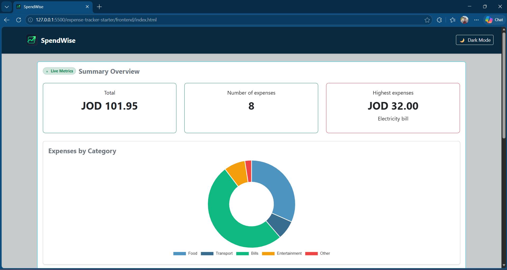
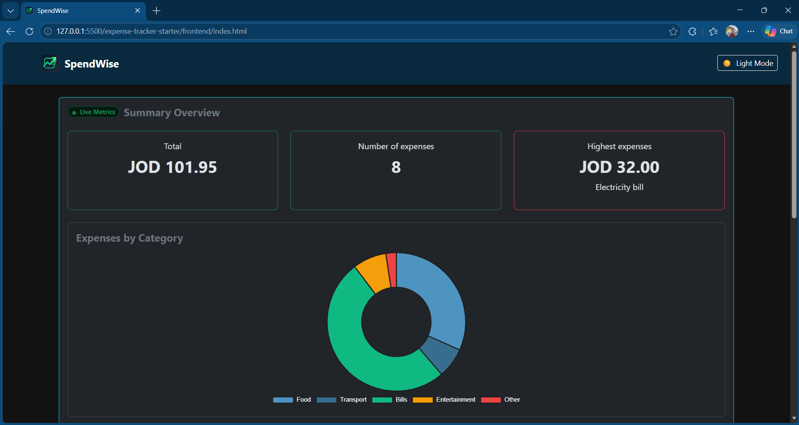
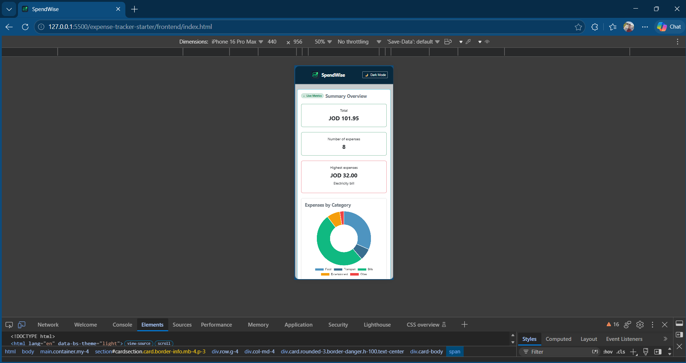
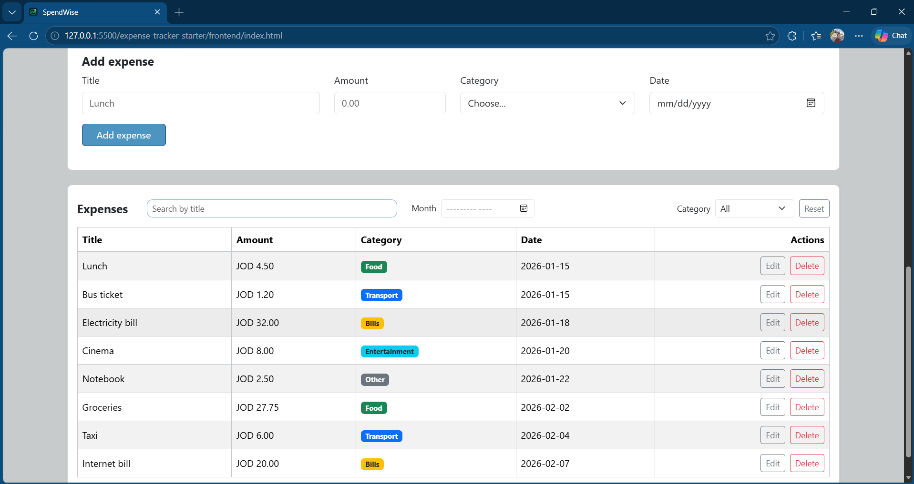
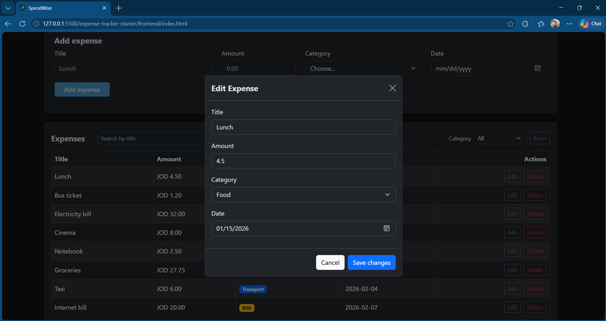
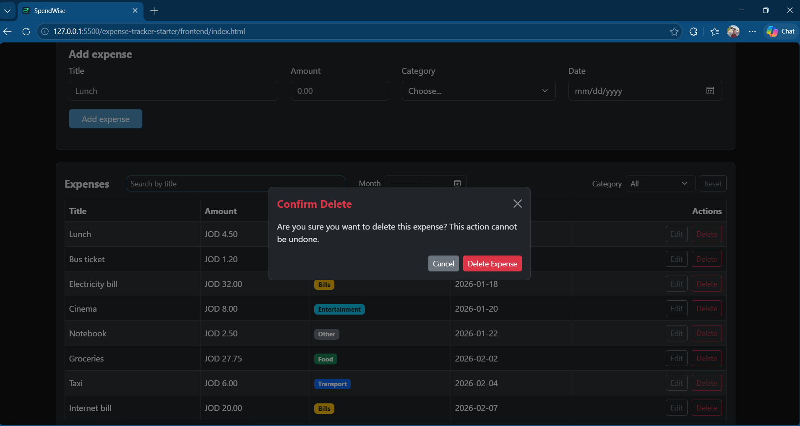

# Expense Tracker

A simple web app to track daily expenses with category filtering and summary stats. Built with HTML, Bootstrap, JavaScript, and a Node.js/PostgreSQL backend.

## How to run

Follow these steps to set up the database, start the server, and launch the application locally.

**Backend**

1. **Set up the Database**:
   The project includes a ready-to-use `schema.sql` file that creates the database, sets up tables, and inserts sample data automatically. You can run it in:

   - **Via pgAdmin**:
     Open pgAdmin, open the Query Tool, copy & paste the contents of `schema.sql`, and click **Execute (F5)**.

**Frontend**

1. Make sure the backend server is running in the background on `http://localhost:3000`.
2. Open the project in **VS Code**.
3. Right-click on `index.html` and select **Open with Live Server**, or simply double-click the `index.html` file to open it in any browser.

## Features

- [x] Add an expense (with validation)
- [x] Delete an expense
- [x] Edit an expense
- [x] Filter by category
- [x] Summary cards (total, count, highest)
- [x] Dark / Light mode toggleV
- [x] Data is saved in a PostgreSQL database

## Screenshots

### Desktop View

### Desktop View Dark Mode

### Mobile View

### Expenses View

### Edite Expenses View

### Delete Expenses View

## What was the hardest part?

Building the table would have been much easier with `innerHTML`, but following the project requirements, I built it entirely using DOM methods (`createElement` and `appendChild`). Creating each cell, setting up the category badges, and attaching click events for the Edit and Delete buttons.